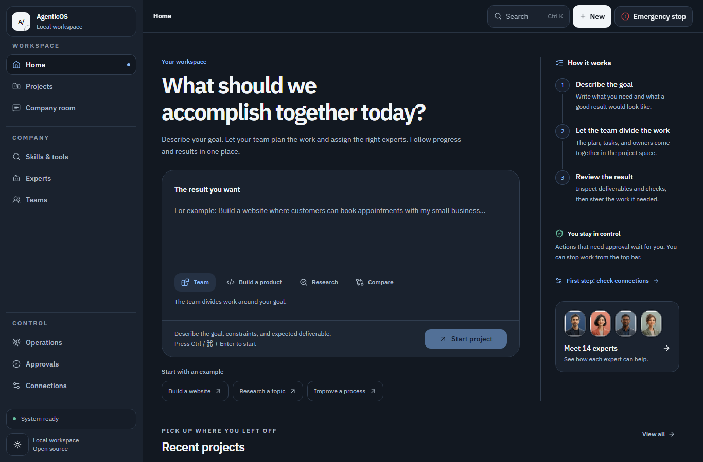

# Agentic Company OS

### 交辦工作，看見進展，掌握控制權。

一個開放原始碼的 AI 代理工作空間：代理可以使用工具、記錄任務，並按照你設定的權限進行工作。

[**開始使用**](#快速開始) · [**認識工作空間**](#認識各個頁面) · [**網站**](https://halittayyar0.github.io/Agentic-Company-OS/)

[English](./README.md) · [Türkçe](./README.tr.md) · [Deutsch](./README.de.md) · [Русский](./README.ru.md) · [简体中文](./README.zh-CN.md) · [繁體中文](./README.zh-TW.md) · [العربية](./README.ar.md)

**Windows · macOS · Linux** &nbsp; / &nbsp; **7 種語言** &nbsp; / &nbsp; **MIT 授權**

## 用來交辦與追蹤工作的空間

交給代理一項明確的任務，或安排依排程重複執行的職責。它可以使用你允許的工具、儲存結果，並在缺少資訊或需要核准時詢問你。你可以在同一個介面追蹤進度、檢查執行過程，也可以停止執行。

每次安裝都是在你的電腦或伺服器上執行的**單人私人工作空間**。模型供應商由你選擇，存取憑證由你保管。公開網站用來引導安裝；任務在你自己的工作空間中執行。

| 從單次任務開始                         | 或安排一項例行職責                     |
| -------------------------------------- | -------------------------------------- |
| 比較三款產品，並附上來源連結。         | 每天檢查公開網頁，記錄有意義的變化。   |
| 檢查 CSV 檔案中的遺漏值與重複值。      | 依排程審閱定期報告。                   |
| 檢閱程式碼儲存庫，提出經過測試的修改。 | 重複執行指定的檢查清單，保留每輪結果。 |

這些是任務範例，並非結果保證。結果取決於模型、可用工具、權限，以及你提供的資訊。

## 快速開始

### 1. 下載原生安裝包

在[版本頁面](https://github.com/halittayyar0/Agentic-Company-OS/releases/latest)選擇適合電腦的最新原生安裝包，核對版本與校驗碼。套件已包含 Node.js、PostgreSQL 和編譯好的應用程式，無需另外安裝 Node.js、Docker、pnpm、Git 或 PostgreSQL。

| 系統                | 壓縮包                                   |
| ------------------- | ---------------------------------------- |
| Windows x64         | `Agentic-Company-OS-win32-x64.zip`       |
| macOS Intel         | `Agentic-Company-OS-darwin-x64.tar.gz`   |
| macOS Apple Silicon | `Agentic-Company-OS-darwin-arm64.tar.gz` |
| Linux x64           | `Agentic-Company-OS-linux-x64.tar.gz`    |
| Linux ARM64         | `Agentic-Company-OS-linux-arm64.tar.gz`  |

目標系統：Windows 10 (1903+)/11 x64、Intel/Apple Silicon 上的 macOS 15，以及 x64/ARM64 上的 Ubuntu 24.04。Linux 套件以 Ubuntu 24.04/glibc 為建置基準；較舊的 glibc 和 Alpine/musl 不在支援範圍內。沒有 Windows ARM64 原生套件。Windows/macOS 套件未簽署，也未提供 macOS 公證或 SmartScreen 信譽保證。請核查系統正常的信任提示與校驗碼，不要關閉系統安全防護。

### 2. 開啟工作空間

將**整個壓縮包**解壓到一個資料夾。Windows 按兩下 `START.cmd`；macOS 開啟 `START.command`，也可在 macOS/Linux 終端機執行 `./START.command`。請將檔案放在一起。啟動器會開啟私人本機瀏覽器連結，並在終端機列印備用連結。選擇七種語言之一、檢查權限並連接模型。

應用程式預設僅綁定回環位址（`127.0.0.1`）。保持終端機開啟；**Ctrl+C** 會停止應用程式、工作程序和私人資料庫。無瀏覽器模式：`START.cmd --no-browser` 或 `./START.command --no-browser`。資料與金鑰儲存在套件外的私人安裝目錄。請保留該目錄和原始套件；在原位置再次啟動同一套件會接續已記錄的安裝。跨套件資料移轉和升級並未自動化；請保留已驗證的備份並遵循[升級指南](./docs/self-hosting.md#upgrades)。

套件不含模型權重或供應商存取權。AI 任務需要設定好的 Ollama 模型或可用的供應商連線；雲端供應商可能收費。本機實用檢查無需付費供應商即可執行。

首次使用本機模型時，開啟**連接模型 → 本機模型**。應用程式提供適用於模型伺服器作業系統的
Ollama 官方安裝指南。執行 Ollama 0.40.3 或更新版本，儲存其私有位址，再選擇**下載模型**。
入門模型會在該伺服器上佔用約 2 GB，另需暫存檔空間。檢查通過後返回保留的工作草稿，
自行決定何時開始。已經等待該模型的工作可能繼續執行。
[下載、儲存與復原 →](./docs/local-models.md#get-your-first-local-model)

進階選項：獨立的 [Docker 套件](./docs/self-hosting.md#portable-container-installer)和[原始碼安裝](./docs/self-hosting.md#source-installation-prerequisites)保留各自的先決條件。

### 3. 明確交辦第一項工作

建立專案、選擇代理，並描述你希望得到的結果。先從容易查核的任務開始：

> 比較 [主題] 的三個選項。使用第一手來源，附上連結與日期，並儲存一頁比較報告。除非需要獨立進行工作，否則持續使用同一個代理。如果缺少必要資訊，請詢問我。

對於定期工作，請同時說明執行間隔與每輪的完成條件：

> 每 24 小時檢查一次 [公開網頁] 是否出現有意義的變化。有變化時，儲存附日期的摘要。完成每輪後，等待下一個排定時間。不要聯絡任何人，也不要對外發布內容。

**實用的任務說明包括：** 輸入資訊、預期輸出、查核方法，以及對操作或支出的限制。

點選 **下載摘要 (.txt)**，即可將已儲存的交付摘要下載為本機文字檔。檔案包含專案目前狀態與代理報告，下載不消耗模型 Token。[儲存交付摘要 →](./docs/delivery-summary.md)

## 認識各個頁面

| 頁面                     | 用途                                           |
| ------------------------ | ---------------------------------------------- |
| **首頁**                 | 查看代理、進行中的工作與近期活動。             |
| **專案**                 | 集中管理任務說明、對話、委派工作、會議與結果。 |
| **專家與團隊工作室**     | 調整代理角色與模型，或從團隊範本開始。         |
| **技能與工具**           | 瀏覽工作指南、查看工具需求，並建立專案草稿。   |
| **核准**                 | 在執行前審閱需要你決定的操作。                 |
| **執行管理與執行檢查器** | 查看執行記錄、工具活動、中斷與復原情況。       |
| **公司聊天室**           | 與選定的代理交談，使用提及功能指定參與者。     |
| **設定**                 | 設定模型連線、語言、執行原則與原始碼工作空間。 |

**技能（skill）** 是完成工作的指南。**工具** 執行具體操作，例如檢查資料或使用瀏覽器。**代理** 結合指令、模型與獲准使用的工具處理任務。

## 實用工具，也支援擴充

內建程式庫涵蓋**研究、軟體、資料、文件與日常營運**，包含工作指南、功能工具與執行階段工具。代理可以尋找指南，並在需要時載入其中的指令。

- **加入自己的指南。** 建立、編輯、匯入或匯出個人技能與輔助工具預設組態。
- **新增可執行工具。** 在編輯器中定義 Node 工具；執行遵循設定的權限與核准規則。[工具撰寫指南 →](./docs/personal-programs.md)
- **處理原始碼。** 連接 Git 儲存庫，讓代理在隔離副本中提出修改，檢查差異並執行驗證後再套用。部署是獨立步驟。[原始碼工作流程 →](./docs/source-workspaces.md)

[瀏覽技能與工具指南 →](./docs/skills-and-tools.md)

## 依任務規模使用資源

例行任務從經濟型模型路由開始。額外的工具定義依需求載入。現有代理可以重複使用，任務委派由伺服器檢查：預設情況下，每個任務群組（含父任務）最多有**四個作用中任務**。

父任務等待作用中的子任務時，不會呼叫模型。定期工作會在排定的週期之間等待。用量檢查涵蓋執行呼叫與結果審查呼叫，既有每項任務或每輪的限制，也有定期工作的滾動每日額度。

**模型費用由你的選擇決定。** 雲端模型透過你自己的供應商帳戶計費；本機模型使用你的硬體。明確選擇免費或本機模型時，系統不會暗中改用付費模型。正在執行的請求可能讓已記錄用量超出限制，未回報的費用仍視為未知。需要控制帳單上限時，請在供應商端設定限制。

[模型路由、委派與預算設定 →](./docs/efficient-work.md)

## 你的工作空間，由你選擇存取方式

在安裝時或設定中選擇**唯讀、需要核准、完整存取或自訂原則**。完整存取允許在已啟用工具中執行更多操作；主機執行仍有獨立的設定與控制。啟用廣泛的主機存取前，請閱讀[安全模型](./docs/security-model.md)。

**在手機上：** 透過私人 HTTPS 連線開啟同一個響應式介面。選用的安裝流程使用既有 Tailscale 連線；文件也介紹了自行管理 VPN 的方式。主機必須保持連線。[手機存取指南 →](./docs/mobile-access.md)

**使用你的語言：** English · Türkçe · Deutsch · Русский · 简体中文 · 繁體中文 · العربية。阿拉伯語支援由右至左的版面配置。自訂指令、外部輸出與歷史記錄保留原始文字。[翻譯涵蓋範圍 →](./docs/localization.md)

> [!NOTE]
> 目前每次安裝僅支援一名受信任的操作人員，不包含共用多使用者帳戶或租戶隔離。請保持遠端存取私密，並以 HTTPS 與操作人員身分驗證保護存取。

## 已完成的驗證

**0.2.0 版本**包含預先建置的 Linux amd64/arm64 映像檔與引導式安裝程式。記錄的驗收結果包括：

- **1,479 項原始碼測試通過**，零失敗，六項因環境條件略過；PostgreSQL 並行處理檢查另行執行。
- **922 項瀏覽器測試通過**，以及 Windows、Intel Mac 和 Apple Silicon Mac 檢查。
- 實際容器安裝與接續安裝、短時間復原與持續執行檢查，以及使用真實模型對一項有限任務和兩個定期週期進行的限定範圍驗證。
- 無須登入的套件下載、校驗碼相符，以及公開起始頁在手機寬度下的七種語言檢查。

這些結果僅適用於所述版本。24 小時持續執行測試、實體手機與行動網路驗收，以及母語使用者審校仍未完成。開放式任務可能需要你的補充資訊或決定，無法保證每一種工作都能完成。

[版本與證據](https://github.com/halittayyar0/Agentic-Company-OS/releases/tag/v0.2.0) · [目前 CI](https://github.com/halittayyar0/Agentic-Company-OS/actions) · [驗證範圍](./docs/verification/2026-09-29-efficient-autonomy.md)

## 進一步了解

| 我想……                         | 閱讀文件                                                         |
| ------------------------------ | ---------------------------------------------------------------- |
| 安裝、重新啟動或備份工作空間   | [自行託管](./docs/self-hosting.md)                               |
| 設定環境變數或執行開發伺服器   | [操作與開發參考](./docs/operator-reference.md)                   |
| 了解 API、背景工作程序與資料庫 | [架構](./docs/architecture.md)                                   |
| 了解權限與仍然存在的風險       | [安全模型](./docs/security-model.md)                             |
| 追蹤變更與後續計畫             | [更新日誌](./CHANGELOG.md) · [路線圖](./docs/roadmap.md)         |
| 貢獻程式碼、文件或翻譯         | [貢獻指南](./CONTRIBUTING.md) · [行為準則](./CODE_OF_CONDUCT.md) |
| 私下回報安全漏洞               | [安全回報](./SECURITY.md)                                        |

連結中的技術文件以英語為主。歡迎範圍明確的小型貢獻：可重現的錯誤回報、更清楚的翻譯、實用指南或經過測試的修正。

**模型連線，適用於 v0.4.0 及更新版本：**[連線指南](./docs/model-connections.zh-TW.md)介紹本機模型、ChatGPT、API 金鑰及首次任務草稿的保留。較早的安裝套件不包含此流程。

中斷後，可在專案或代理頁面開啟**模型用量紀錄**查看請求。檢查不消耗模型 token，也不會重新傳送請求；未知用量不會被視為零。[了解用量紀錄 →](./docs/inference-accounting.md)

---

**以 [MIT 授權條款](./LICENSE)開放原始碼。** 隨附的 IBM Plex 字型採用 SIL Open Font License 1.1；請參閱[第三方聲明](./artifacts/agentic-company-os/public/THIRD_PARTY_NOTICES.txt)。
